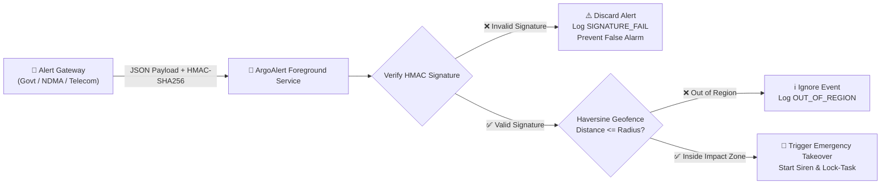
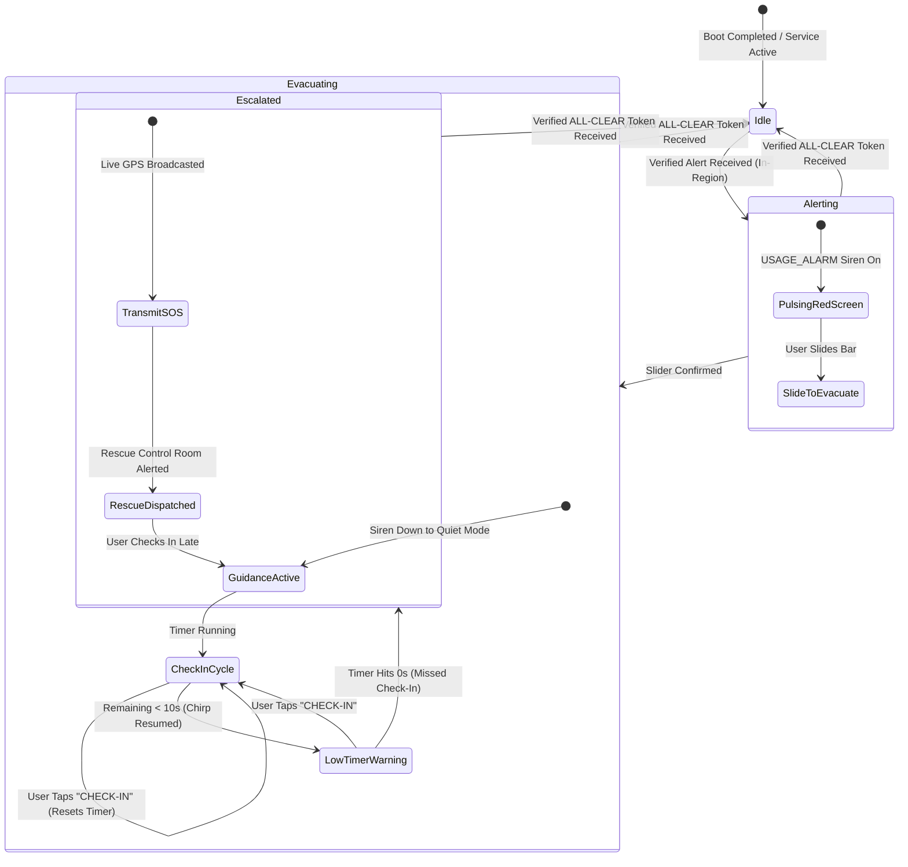

<div align="center">

<pre>
   █████╗ ██████╗  ██████╗  ██████╗ ███╗   ██╗ █████╗ ██╗   ██╗██╗███████╗
  ██╔══██╗██╔══██╗██╔════╝ ██╔═══██╗████╗  ██║██╔══██╗██║   ██║██║██╔════╝
  ███████║██████╔╝██║  ███╗██║   ██║██╔██╗ ██║███████║██║   ██║██║███████╗
  ██╔══██║██╔══██╗██║   ██║██║   ██║██║╚██╗██║██╔══██║╚██╗ ██╔╝██║╚════██║
  ██║  ██║██║  ██║╚██████╔╝╚██████╔╝██║ ╚████║██║  ██║ ╚████╔╝ ██║███████║
  ╚═╝  ╚═╝╚═╝  ╚═╝ ╚═════╝  ╚═════╝ ╚═╝  ╚═══╝╚═╝  ╚═╝  ╚═══╝  ╚═╝╚══════╝
</pre>

### **Mission-Critical Emergency Life-Safety & Evacuation System**
*Autonomous device takeover, tamper-proof early warning, real-time shelter navigation, and automatic rescue escalation.*

---

[](https://argonavis.web.app)
[-3DDC84?style=for-the-badge&logo=android&logoColor=white)]([https://developer.android.com/](https://github.com/2pro4youx/Argo-Navis/releases/tag/debug-unstable-v1))
[](https://kotlinlang.org/)
[](https://developer.android.com/jetpack/compose)
[](#-cryptographic-tamper-proofing)
[](#-system-architecture)
[](LICENSE)

[🌐 Showcase Website](website/index.html) • [Overview](#-overview) • [Core Capabilities](#-core-capabilities) • [System Architecture](#-system-architecture) • [Evacuation Flow](#-evacuation-flow) • [Disaster Protocols](#-disaster-specific-safety-protocols) • [Getting Started](#-getting-started) • [Control Room Gateway](#-control-room-gateway--simulator) • [Vision](#-the-vision-for-argonavis)

---

</div>

## 📌 Overview

**ArgoNavis** is a life-safety Android emergency override platform engineered to cut through noise, panic, and confusion during natural catastrophes. Traditional disaster push alerts are passive text notifications easily lost among app notifications, muted by Do Not Disturb, or ignored during critical minutes.

**ArgoNavis functions as an OEM-grade emergency layer:**
When a signed, localized disaster alert is verified, **ArgoNavis commandeers the device**:
1. **Bypasses lockscreens, DND, and ongoing tasks** using full-screen intent and lock-task kiosk enforcement.
2. **Fires a synthesized alternating dual-tone emergency siren** on the hardware alarm stream alongside tactile vibration patterns.
3. **Presents instant, disaster-specific evacuation protocols** (Cyclones, Floods, Tsunamis, Earthquakes, Wildfires).
4. **Calculates the fastest trajectory to nearest relief shelters** rendered on an offline, low-latency schematic radar vector map.
5. **Maintains a dead-man's check-in loop**: if the user becomes unresponsive or trapped, it automatically transmits their exact GPS coordinates, battery reserve, and status to local emergency services and rescue command teams.

---

## ⚡ Core Capabilities

<table>
<tr>
<td width="50%">

### 🛑 Zero-Compromise Device Takeover
* **Hardware & Lock Screen Override**: Automatically wakes display (`turnScreenOn`), draws over keyguard (`showWhenLocked`), and dismisses the lock screen.
* **Kiosk Lock-Task Enforcement**: Disables back navigation, notification pulldowns, recents, and home gestures so the user cannot accidentally close the evacuation screen during a crisis.
* **Direct Boot Aware**: Runs even before the user inputs their post-reboot PIN/pattern.
* **DND Bypass & Hardware Siren**: Synthesizes a piercing 960 Hz / 720 Hz alert siren directly on `AudioAttributes.USAGE_ALARM` with volume override.

</td>
<td width="50%">

### 🧭 Offline Vector Radar & Shelters
* **Real-Time Proximity Computation**: Implements spherical Haversine trigonometry to determine distance and bearing to all gazetted emergency relief shelters.
* **Schematic Radar Canvas**: Custom Jetpack Compose Canvas projection mapping user and shelter positions with zero external tile/network dependencies.
* **High-Visibility Route Vector**: Direct bearing line to the safest relief shelter updated live as the evacuee moves.
* **One-Tap 112 SOS**: Integrated direct dialer launcher to national emergency services.

</td>
</tr>
<tr>
<td width="50%">

### 📋 Authoritative Disaster Protocols
* **Contextual Evacuation Guides**: Tailored, step-by-step NDMA/SDMA-aligned guidelines dynamically loaded based on event taxonomy:
  * 🌊 **Flood**: High ground relocation, avoiding moving water, electrical mains cutoff.
  * 🌀 **Cyclone**: Immediate shelter landfall evacuation, emergency go-bag checklist.
  * 🌊 **Tsunami**: Rapid inland movement, multiple wave surge warnings.
  * 🌋 **Earthquake**: Drop, cover, hold on, open ground protocols, aftershock safety.
  * 🌲 **Wildfire**: Designated route traversal, smoke filtration, register arrival.

</td>
<td width="50%">

### ⏱️ Dead-Man Check-In & Auto-SOS
* **Active Countdown Watchdog**: Configurable interval check-in button with a visual animated sweep ring.
* **Low-Timer Warning**: Soft siren chirps when under 10 seconds to prompt the evacuee to confirm safety.
* **Automatic Emergency Escalation**: If a check-in expires, ArgoNavis triggers an emergency beacon transmitting real-time GPS telemetry, battery levels, and SOS status to the central rescue control room.
* **Low-Power Reserve Mode**: Operates reliably even under critical battery levels (< 5% battery reserve).

</td>
</tr>
</table>

---

## 🔐 Cryptographic Tamper-Proofing

To prevent state-sponsored spoofing, malicious hoaxes, or panic-inducing forged alerts, ArgoNavis employs an asymmetric/HMAC signature verification layer prior to executing any device override:



* **Constant-Time Verification**: Prevents timing attacks with constant-time byte comparisons (`MessageDigest.isEqual`).
* **Cryptographic All-Clear**: The takeover cannot be dismissed by unauthorized entities; it requires a signed `aid|CLEARED` token to gracefully release the device.

---

## 🔄 Evacuation Flow & State Machine



---

## 🏗️ System Architecture

```
app/src/main/java/com/argo/alert/
├── AdminReceiver.kt       # DeviceAdminReceiver: LockTask whitelist & kiosk owner
├── AlertActivity.kt       # Compose UI: Emergency Takeover, Map Canvas, Protocol & Check-in
├── AlertModels.kt         # Domain models: AlertPayload, Shelter, GeoPoint, JSON Parser
├── AlertService.kt        # Foreground service: 2s HTTP polling, WakeLock, notification channels
├── AlertStateHolder.kt    # Thread-safe StateFlow store for UI and service synchronization
├── BootReceiver.kt        # Direct-Boot & LOCKED_BOOT_COMPLETED receiver
├── CryptoAndGeo.kt        # HMAC-SHA256 signature verification & Haversine distance calculations
├── DeviceTelemetry.kt     # GPS LocationManager & BatteryManager integration
├── EventClient.kt         # HTTP gateway client: telemetry, heartbeat, event reporting
├── MainActivity.kt        # Diagnostic launcher: setup, permission verification & mock tooling
└── SirenController.kt     # Low-level AudioTrack dual-tone synthesis & VibratorManager
```

---

## 🚀 Getting Started

### Prerequisites
* **Android Studio**: Koala / Iguana or later
* **Android SDK**: Min SDK 26 (Android 8.0 Oreo), Target SDK 34 (Android 14)
* **JDK**: Version 17
* **Python**: Python 3.8+ (for running the demo Alert Gateway & Control Room)

### 1. Clone & Build
```bash
# Clone the repository
git clone https://github.com/2pro4youx/ArgoNavis.git
cd ArgoNavis

# Build debug APK via Gradle Wrapper
./gradlew assembleDebug
```

### 2. Device Administration & Permissions Setup
To enable true emergency kiosk hijacking (`LockTaskMode`), the app can be provisioned as a Device Owner on dedicated devices or granted Device Administrator rights:

```bash
# Install to connected device / emulator
adb install -r app/build/outputs/apk/debug/app-debug.apk

# (Optional) Grant Device Owner permissions for seamless Lock-Task Kiosk
adb shell dpm set-device-owner com.argo.alert/.AdminReceiver

# Grant required runtime permissions
adb shell pm grant com.argo.alert android.permission.ACCESS_FINE_LOCATION
adb shell pm grant com.argo.alert android.permission.ACCESS_COARSE_LOCATION
adb shell pm grant com.argo.alert android.permission.POST_NOTIFICATIONS
adb shell appops set com.argo.alert SYSTEM_ALERT_WINDOW allow
```

---

## 🖥️ Control Room Gateway & Simulator

The project includes `argo_sim.py`, an all-in-one command center and telemetry server using Python's standard library.

```bash
# Start the Alert Gateway and Rescue Control Room
python argo_sim.py server --port 8000
```
Open **`http://localhost:8000`** in any browser to access the live dashboard.

---

## 🔮 The Vision for ArgoNavis

The long-term vision of **ArgoNavis** is to transcend standard user-installed applications and become a permanent, universally adopted **Bootloader-Level Emergency Life-Safety Layer** pre-integrated into every smartphone worldwide:

1. **Native Bootloader-Level Integration & Zero Setup**:
   * **Pre-installed Out of the Box**: Shipped at the silicon, firmware, and OEM bootloader level (AOSP / Linux microkernel integration) before the device ever reaches the consumer.
   * **Zero User Setup Required**: Citizens never need to download an application, register an account, configure push channels, or grant complex runtime permissions. From the very first boot, the phone is permanently primed to protect human life.
   * **Continuous Guardian Baseline**: As long as the phone is operating, ArgoNavis vigilantly listens to authenticated emergency broadcasts and triggers life-safety interventions the moment danger threatens the owner's coordinates.

2. **Autonomous Power Reallocation & The 5–10% Battery Reservation**:
   * **Deep Power Management Architecture**: By redefining the Power Management IC (PMIC) and low-level shutdown firmware, modern smartphones will reserve a protected **5% to 10% slice of maximum battery capacity** exclusively for ArgoNavis.
   * **Active Protection When the Phone is "Switched Off"**: When standard Android or iOS declares 0% battery and enters a normal shutdown state, the device does not cut power completely. Instead, it enters an ultra-low-quiescent-current **Emergency Standby Sub-State**.
   * **Minimal Energy Flow to GPS & Trigger Subsystems**: Minimal power continues to trickle to the GNSS/GPS baseband receiver, low-power broadcast radio (Cell Broadcast / FM / Satellite alert listener), and the emergency audio amplifier.
   * **Life-Saving Alarms on "Dead" Phones**: If a catastrophic earthquake, cyclone, flash flood, or tsunami occurs while the phone is ostensibly "powered off" or dead, the ArgoNavis hardware interrupt wakes the critical alarm circuit, sounds the evacuation siren, powers on high-contrast guidance, and broadcasts rescue coordinates—ensuring that citizens are alerted and rescued even when they thought their phone had no battery remaining.

---

## 📄 License

This project is licensed under the [MIT License](LICENSE) — engineered for humanitarian life-safety, public resilience, and emergency response research.

<div align="center">
<b>ArgoNavis</b> — <i>Guiding humanity through the storm.</i>
</div>
