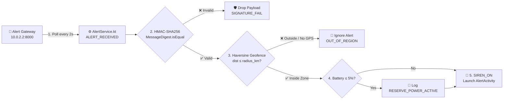
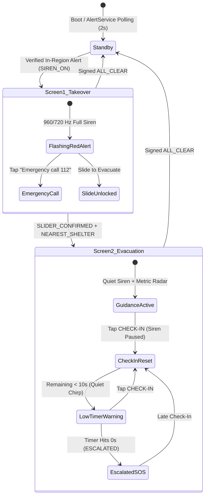

<div align="center">

<table align="center">
<tr>
<td>
<pre>
 █████╗ ██████╗  ██████╗  ██████╗      █████╗ ██╗     ███████╗██████╗ ████████╗
██╔══██╗██╔══██╗██╔════╝ ██╔═══██╗    ██╔══██╗██║     ██╔════╝██╔══██╗╚══██╔══╝
███████║██████╔╝██║  ███╗██║   ██║    ███████║██║     █████╗  ██████╔╝   ██║   
██╔══██║██╔══██╗██║   ██║██║   ██║    ██╔══██║██║     ██╔══╝  ██╔══██╗   ██║   
██║  ██║██║  ██║╚██████╔╝╚██████╔╝    ██║  ██║███████╗███████╗██║  ██║   ██║   
╚═╝  ╚═╝╚═╝  ╚═╝ ╚═════╝  ╚═════╝     ╚═╝  ╚═╝╚══════╝╚══════╝╚═╝  ╚═╝   ╚═╝   
</pre>
</td>
</tr>
</table>

### 🚨 **OEM-Grade Android Emergency Alert & Evacuation Layer (`com.argo.alert`)**
*Direct-boot takeover, constant-time HMAC-SHA256 verification, offline metric radar routing, and dead-man rescue escalation.*

---

[-3DDC84?style=for-the-badge&logo=android&logoColor=white)](https://developer.android.com/)
[](https://kotlinlang.org/)
[](https://developer.android.com/jetpack/compose)
[](#-cryptographic-verification-pipeline)
[-0F172A?style=for-the-badge)](#%EF%B8%8F-architecture--source-map)

[📌 Overview](#-overview) • [⚡ Core Capabilities](#-core-capabilities) • [🔐 Verification Pipeline](#-cryptographic-verification-pipeline) • [🔄 Evacuation State Machine](#-evacuation-state-machine) • [🏗️ Architecture](#%EF%B8%8F-architecture--source-map) • [🚀 Getting Started](#-getting-started) • [📡 Wire Contract](#-backend-wire-contract)

</div>  

---

## 📌 Overview

**Argo Alert** (`com.argo.alert`) is a native **Kotlin + Jetpack Compose** emergency life-safety layer built with **zero third-party runtime dependencies**. Instead of relying on passive push notifications that get buried, silenced by Do Not Disturb, or blocked by Google Play Services outages, Argo Alert operates directly on core Android platform APIs (`Service`, `DevicePolicyManager`, `LocationManager`, `AudioTrack`, `javax.crypto`, and `HttpURLConnection`).

When a cryptographically signed, geofenced disaster alert arrives, the app:
1. 🔓 **Wakes the screen and overrides the lock screen & DND** in kiosk lock-task mode.
2. 🔊 **Drives a dual-tone `960 Hz / 720 Hz` hardware alarm siren** with accessibility vibration and flashing red visuals.
3. 🧭 **Projects the nearest relief shelters** onto a zero-network `cos(lat)` metric Canvas map with disaster-specific instructions.
4. ⏱️ **Runs a dead-man's check-in countdown** that automatically escalates GPS telemetry to rescue dispatch if the user stops responding.

---

## 🚀 Release Update — Wireless Firebase Sync & Stability Fixes

### ✨ What's New
- ☁️ **Zero-IP Wireless Sync (Firebase RTDB):** Added Firebase Realtime Database integration so the Android app and PC control room (`ArgoNavisSimulation.py`) communicate over any Wi-Fi or mobile data network—no LAN IP addresses or USB `adb reverse` setup required.
- 📱 **One-Tap Firebase Preset:** Added a **Firebase (Default)** quick-select button in the Android app alongside **USB 127.0.0.1** and **Emu 10.0.2.2** for instant switching.
- 🔄 **Live Gateway Sync:** `ArgoNavisSimulation.py` now automatically pushes active alerts and all-clear signals to Firebase RTDB while syncing live device GPS, battery telemetry, and firmware events (`--firebase` flag, enabled by default).
- 🛡️ **Direct Boot Compatible:** Uses lightweight HTTPS REST calls in `EventClient.kt`, keeping background alert polling functional even before device unlock.

### 🐛 Bug Fixes
- 🔧 **Fixed Android Studio APK / Test Build Failure:** Resolved a `compose-bom` version conflict (`2026.02.01` vs `2024.09.03`) between `gradle/libs.versions.toml` and `app/build.gradle.kts` that caused `:app:assembleDebugAndroidTest` tasks to fail.
- 🔒 **Fixed Control Room Deadlock:** Replaced non-reentrant `threading.Lock()` with `threading.RLock()` and moved Firebase sync calls outside the lock in `ArgoNavisSimulation.py`, fixing unresponsive **Send all-clear** and **Reset demo** buttons.
- 📡 **Fixed Intermittent Missing Devices & Reset Race:** Added epoch/reset guards to the Firebase sync loop so devices stay consistently visible without restarting the Python server, and stale polls no longer repopulate cleared state after **Reset demo**.

### ⚡ Quick Start
1. Install the updated `app-debug.apk` on your Android device (uses **Firebase (Default)** out of the box).
2. Start the PC control room:
   ```bash
   python "Python File/ArgoNavisSimulation.py" server --port 8000
   ```
3. Open `http://localhost:8000` in your browser to monitor your device and dispatch alerts wirelessly.

---

## ⚡ Core Capabilities

<table>
<tr>
<td width="50%" valign="top">

### 🛑 Zero-Compromise Device Takeover
- 🔋 **Direct-Boot Aware**: Launches via `LOCKED_BOOT_COMPLETED` (`directBootAware="true"`) before the user unlocks their phone.
- 🔒 **Lock-Task Kiosk Mode**: Uses `AdminReceiver` (`DeviceAdminReceiver`) to whitelist `com.argo.alert` for `startLockTask()`, blocking accidental dismissal.
- 💡 **Lock Screen & Overlay Bypass**: Wakes display (`turnScreenOn`), renders over keyguard (`showWhenLocked`), and includes a `FullScreenIntent` notification fallback.
- ⚡ **5% Reserve Power Mode**: Detects `BatteryManager` levels `<= 5%` and emits `RESERVE_POWER_ACTIVE` while preserving alert delivery.

</td>
<td width="50%" valign="top">

### 🔊 Hardware Siren & Accessibility
- 🎵 **Synthesized `USAGE_ALARM` Siren**: `SirenController` generates an alternating **960 Hz / 720 Hz** tone (400 ms half-cycle) directly via `AudioTrack`.
- 📢 **Volume Override**: Automatically raises the system alarm stream to maximum on takeover, then steps down to quiet (`20%`) or paused mode during evacuation.
- 📳 **Tactile & Visual Alerts**: Paired repeating `VibrationEffect` patterns and high-contrast flashing red Screen 1 UI for deaf / hard-of-hearing accessibility.
- 📞 **One-Tap `112` Dialer**: Direct `Intent.ACTION_DIAL` emergency button (`tel:112`) accessible over the lock screen.

</td>
</tr>
<tr>
<td width="50%" valign="top">

### 🧭 Offline Radar & Shelter Guidance
- 🛰️ **Pure `LocationManager` GPS**: Arbitrates `GPS_PROVIDER` and `NETWORK_PROVIDER` fixes without Google Play Services, rejecting invalid `(0.0, 0.0)` fixes.
- 📐 **Isotropic Metric Canvas Map**: Custom Jetpack Compose `Canvas` projection with `cos(lat)` scaling, scale bar, North indicator, and zero map-tile dependencies.
- 🏥 **Nearest Shelter Vector**: Uses spherical Haversine math to highlight the closest shelter and draw the evacuation bearing/walking path.

</td>
<td width="50%" valign="top">

### ⏱️ Dead-Man Check-In & Auto-SOS
- 🔄 **Animated Countdown Ring**: Large circular **CHECK-IN** control in Screen 2 with color-coded urgency (`Green → Amber < 10s → Red`).
- 🔔 **Low-Timer Chirp**: Re-engages quiet siren prompts when less than 10 seconds remain.
- 🆘 **Automatic Rescue Escalation**: If the countdown reaches `0s`, broadcasts `ESCALATED` with live GPS coordinates to the control room.
- ✅ **Signed Release**: Device only returns to standby upon receiving an HMAC-signed `ALL_CLEAR` token.

</td>
</tr>
</table>

---

## 🔐 Cryptographic Verification Pipeline

Every payload polled from `GET /api/device/poll` passes through **6 deterministic gates** inside `AlertService.kt` before any takeover occurs:



---

## 🔄 Evacuation State Machine



---

## 🏗️ Architecture & Source Map

```text
app/src/main/
├── 📄 AndroidManifest.xml                     # directBootAware, specialUse FGS, emergency permissions
├── 📁 res/
│   ├── 📁 values/
│   │   ├── strings.xml                        # App label ("Argo Alert") & notification channel names
│   │   └── themes.xml                         # Fullscreen dark emergency theme + cutout support
│   └── 📁 xml/
│       ├── device_admin_receiver.xml          # DeviceAdminReceiver lock-task policy metadata
│       └── network_security_config.xml        # Cleartext HTTP scoped strictly to 10.0.2.2
└── 📁 java/com/argo/alert/
    ├── 🛡️ AdminReceiver.kt                   # Device Owner LockTask whitelisting
    ├── 🚨 AlertActivity.kt                   # Compose Screen 1 takeover + Screen 2 map, protocols & check-in
    ├── 📦 AlertModels.kt                     # Domain models & org.json parsers for poll & alert payloads
    ├── ⚙️ AlertService.kt                    # START_STICKY FGS: 2s polling, WakeLock & 6-gate pipeline
    ├── 🔄 AlertStateHolder.kt                # Thread-safe StateFlow store syncing service & Compose UI
    ├── 🔌 BootReceiver.kt                    # LOCKED_BOOT_COMPLETED & BOOT_COMPLETED auto-start
    ├── 🔐 CryptoAndGeo.kt                    # Constant-time HMAC-SHA256, Haversine & nearest shelter
    ├── 📍 DeviceTelemetry.kt                 # LocationManager arbitration & BatteryManager level reader
    ├── 🌐 EventClient.kt                     # Zero-dep HttpURLConnection client (/poll & /event)
    ├── 📱 MainActivity.kt                    # Diagnostic setup screen (permissions, Device Owner, service)
    └── 🔊 SirenController.kt                 # AudioTrack 960/720 Hz USAGE_ALARM & Vibrator controller
```

---

## ⚙️ Tech Stack & Requirements

| Component | Specification |
| :--- | :--- |
| **Language & UI** | Kotlin `2.0.20` · Jetpack Compose BOM `2024.09.03` · Material 3 |
| **Build System** | Android Gradle Plugin `8.5.2` · JDK `17` |
| **SDK Targets** | `minSdk = 26` (Android 8.0 Oreo) · `targetSdk = 34` (Android 14) |
| **External Libraries** | **None** — 100% Android Framework & Java Standard Library |
| **Companion Gateway** | HTTP Server on port `8000` (`http://10.0.2.2:8000` on Android Emulator) |

---

## 🚀 Getting Started

### 1️⃣ Build & Install Debug APK
```bash
./gradlew assembleDebug
adb install -r app/build/outputs/apk/debug/app-debug.apk
```

### 2️⃣ Provision Device Owner *(Optional — Enables Seamless Kiosk Lock-Task)*
Run on a fresh emulator or device with no signed-in accounts so `startLockTask()` pins `AlertActivity` without confirmation:
```bash
adb shell dpm set-device-owner com.argo.alert/.AdminReceiver
```

### 3️⃣ Grant Runtime Permissions & Inject Mock GPS
```bash
adb shell pm grant com.argo.alert android.permission.ACCESS_FINE_LOCATION
adb shell pm grant com.argo.alert android.permission.ACCESS_COARSE_LOCATION
adb shell pm grant com.argo.alert android.permission.POST_NOTIFICATIONS
adb shell appops set com.argo.alert SYSTEM_ALERT_WINDOW allow

# Inject a GPS coordinate into LocationManager (longitude latitude)
adb emu geo fix 139.7671 35.6812
```

### 4️⃣ Test Direct Boot & 5% Reserved Battery Mode
```bash
adb shell dumpsys battery set level 4
adb reboot
```

---

## 📡 Backend Wire Contract

### 🔹 Poll Endpoint *(Every 2 Seconds)*
```http
GET /api/device/poll?device=emu1&lat=<lat>&lon=<lon>&battery=<pct>&src=gps
```

<details>
<summary><b>📥 Active Alert JSON Response</b></summary>

```json
{
  "status": "ACTIVE",
  "payload": "{\"alert_id\":\"argo-eq-01\",\"type\":\"EARTHQUAKE\",\"severity\":\"EXTREME\",\"headline\":\"Evacuate unstable structures immediately.\",\"region\":{\"center\":{\"lat\":35.685,\"lon\":139.77},\"radius_km\":15},\"shelters\":[{\"name\":\"Marunouchi Plaza\",\"lat\":35.6838,\"lon\":139.7642}],\"protocol_steps\":[\"Drop, cover, and hold on.\",\"Use stairs only.\"],\"protocol_note\":\"Civil Protection Directive CP-14\",\"checkin_interval_s\":30}",
  "sig": "<hex HMAC-SHA256 of raw payload>"
}
```

</details>

<details>
<summary><b>🟢 Signed All-Clear JSON Response</b></summary>

```json
{
  "status": "CLEARED",
  "alert_id": "argo-eq-01",
  "clear_sig": "<hex HMAC-SHA256 of 'argo-eq-01|CLEARED'>"
}
```

</details>

### 🔹 Event Telemetry Endpoint
```http
POST /api/device/event
Content-Type: application/json
```
```json
{
  "device": "emu1",
  "event": "NEAREST_SHELTER",
  "detail": "shelter=Marunouchi Plaza distance_km=0.39",
  "lat": 35.6812,
  "lon": 139.7671
}
```

**Ordered Lifecycle Events:**
`ALERT_RECEIVED` → `SIGNATURE_OK` / `SIGNATURE_FAIL` → `IN_REGION` / `OUT_OF_REGION` → `RESERVE_POWER_ACTIVE` → `SIREN_ON` → `SLIDER_CONFIRMED` → `NEAREST_SHELTER` → `CHECKIN` / `ESCALATED` → `ALL_CLEAR`

---

## 🛡️ Security Notes

- 🔑 **Demo Key Warning**: `CryptoAndGeo.SHARED_SECRET` (`argo-demo-shared-secret`) is strictly for local simulator testing. Production OEM builds should use asymmetric signatures backed by Android Keystore / hardware-protected trust anchors.
- 🌐 **Transport Security**: `network_security_config.xml` explicitly scopes cleartext HTTP exclusively to `10.0.2.2`; production deployments must enforce TLS (`https://`).

---

<div align="center">
<b>Argo Alert (<code>com.argo.alert</code>)</b> — <i>Built with pure Kotlin &amp; Jetpack Compose for resilient life-safety response.</i>
</div>